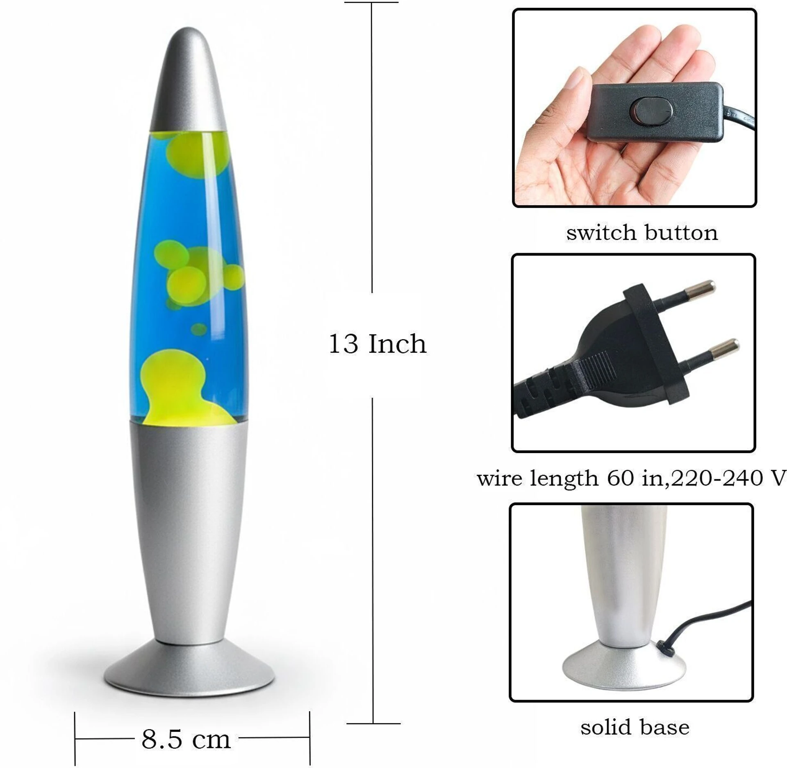
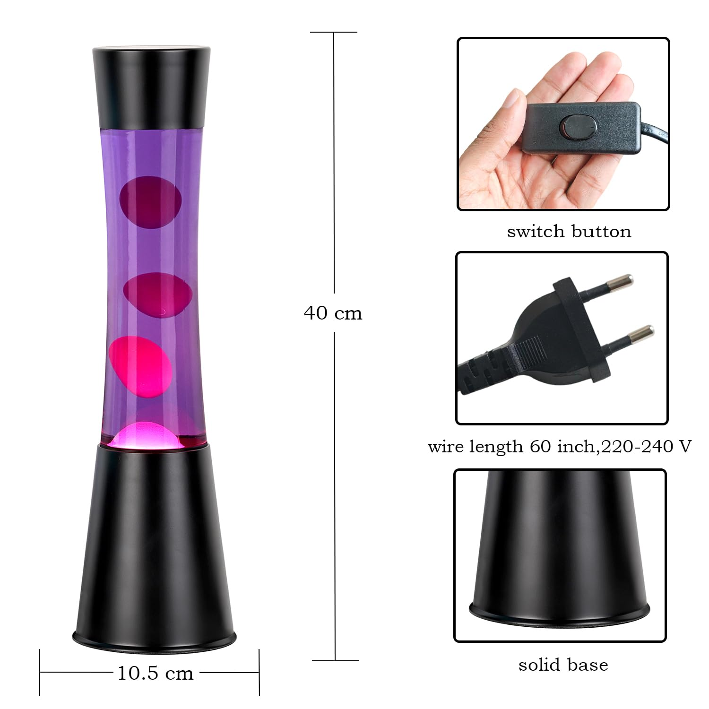
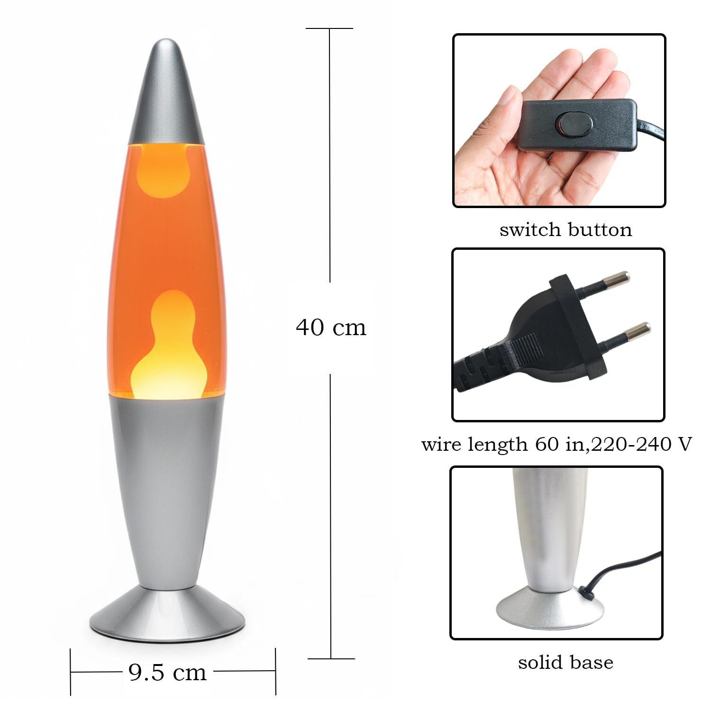

# Prompts

## v1.0

```md
Build a 3D physics playground where you can simulate lava lamps with different densities of emulsions and temperatures based on the viscosity . Make interactions immediate with a simple toolbar and stable simulation.

---

Optimize for performance, make the controls hide able and also allow changing the brightness and add more color choices, allow 2 tones of color one for the liquid and one for wax and finally the wax should start out and coalesce back into a single blob which due to the nature of the container and gravity should have a plan top, add more randomness into the blob shapes as well all of them are round right now

---

Make sure to make it smooth and pretty globules that flow and mix nicely
```

All three images were attached to the prompt.





### Results:

/home/sagnik/Projects/lava-lamp/outputs/v1.0

Note: The rest have not been given images.

## v2.0 - Grok Build

```md
Build a 3D physics playground where you can simulate lava lamps with different densities of emulsions and temperatures based on the viscosity . Make interactions immediate with a simple toolbar and stable simulation.

---

Optimize for performance, make the controls hide able and also allow changing the brightness and add more color choices, allow 2 tones of color one for the liquid and one for wax and finally the wax should start out and coalesce back into a single blob which due to the nature of the container and gravity should have a plan top, add more randomness into the blob shapes as well all of them are round right now
```

### Results:

/home/sagnik/Projects/lava-lamp/outputs/v2.0

# v3.0 - Gemini Argon

```md
Build a 3D physics playground where you can simulate lava lamps with different densities of emulsions and temperatures based on the viscosity . Make interactions immediate with a simple toolbar and stable simulation.


---


Optimize for performance, make the controls hide able and also allow changing the brightness and add more color choices, allow 2 tones of color one for the liquid and one for wax and finally the wax should start out and coalesce back into a single blob which due to the nature of the container and gravity should have a plan top, add more randomness into the blob shapes as well all of them are round right now


---


Make sure to make it smooth and pretty globules that flow and mix nicely
```

Follow up:

```md
It still lacks the full lifecycle like starting from a still pool and then blobs slowly rising combining reaching the top cooling down and falling back down, interacting and the smooth needs of the blobs needs work
```

https://share.gemini.google/FlTLAeBGovGE

## v3.1 - Gemini Argon retry

https://share.gemini.google/qd38C9S84x3s

## v4.0 - DeepSeek v4.1

### No Thinking

https://chat.deepseek.com/share/5q1lpb7ljrhtqk9lpb

### Thinking

https://chat.deepseek.com/share/i65o3ivy0ri023eg4i
